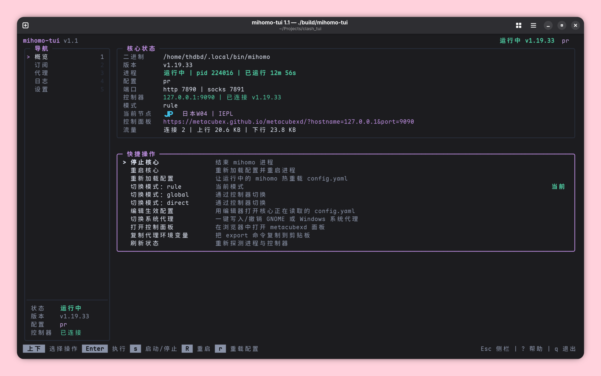

# 🧭 mihomo-tui

> 一个以 mihomo（Clash.Meta）为核心的终端控制台 —— 订阅管理、进程控制、控制器面板三合一。



## ✨ 特性

- 📦 **订阅**：增删改/更新配置文件
- 🧩 **内核**：内置内核管理器，支持从 GitHub 官方一键下载/更新 mihomo，自动识别系统与架构；支持可选 ghproxy / gh-proxy / akams 镜像
- ⚙️ **核心**：自动探测 mihomo、后台启动、停止、重启、热重载、日志查看
- 📊 **面板**：模式切换、当前节点、连接与流量、代理组/节点切换、单点/整组测速、延迟排序
- 🖱️ **交互**：鼠标点击、滚轮、双击支持；纯键盘也行
- ⌨️ **文本编辑**：输入框支持快捷键
- 🎨 **外观**：跟随终端深浅色，6种自定义主题色
- 🚀 **快捷操作**：一键开关系统代理、一键开机自启（systemd 用户服务 / Windows 启动项）、复制代理环境变量、浏览器启动第三方面板等
- 💾 **备份**：一键将设置、订阅索引和全部配置打包成 zip
- 🖥️ **平台**：Linux（amd64 / arm64 / armv7）与 Windows（amd64 / arm64），单文件无依赖

## 📥 安装

### 下载预编译版本

从 [Releases](../../releases) 下载对应平台，解压即用：

| 平台            | 文件                                 |
| --------------- | ------------------------------------ |
| 🐧 Linux x86_64  | `mihomo-tui-vX.Y-linux-amd64.tar.gz` |
| 🐧 Linux arm64   | `mihomo-tui-vX.Y-linux-arm64.tar.gz` |
| 🐧 Linux armv7   | `mihomo-tui-vX.Y-linux-armv7.tar.gz` |
| 🪟 Windows x64   | `mihomo-tui-vX.Y-windows-amd64.zip`  |
| 🪟 Windows arm64 | `mihomo-tui-vX.Y-windows-arm64.zip`  |

### 从源码构建

```sh
dart pub get
dart compile exe bin/mihomo_tui.dart -o build/mihomo-tui   # Windows 用 -o build/mihomo-tui.exe
./build/mihomo-tui
```

需要 Dart 3.5+。

## 🔌 内核

mihomo-tui 没有内置内核，可以自行下载指定路径，程序内也有下载与更新内核的功能。

- 🧩 设置页「更新内核」：从 GitHub 官方获取最新版，自动识别平台与架构（`linux-amd64`、`linux-arm64`、`linux-armv7`、`windows-amd64`、`windows-arm64`），旧文件备份为 `.bak`
- 🪞 「下载镜像」里可选直连或 ghproxy / gh-proxy / akams，并显示每个镜像的连通性检测结果
- 💻 命令行：`mihomo-tui --update-core --mirror gh-proxy`

查找顺序：`--bin` → 设置页 → `MIHOMO_BIN` → 程序目录 → `mihomo/`、`core/` 子目录 → `PATH` 与常见路径。

> ⚠️注意：显式指定但文件不存在时会报错。

## 🚀 使用

```sh
mihomo-tui
```

> 也可能需要先 chmod +x 一下

首次使用：`2` 进订阅页 → `a` 添加订阅 → `Enter` 启用 → `1` 回概览 → `s` 启动核心。

### ⌨️ 快捷键

| 位置 | 按键                       | 作用                                                  |
| ---- | -------------------------- | ----------------------------------------------------- |
| 全局 | `1`–`5`                    | 跳转 概览 / 订阅 / 代理 / 日志 / 设置                 |
| 全局 | `Tab`                      | 侧栏与内容区切换                                      |
| 全局 | `h`                        | 隐藏面板，核心继续后台运行                            |
| 全局 | `?` / `q`                  | 帮助 / 退出（核心不停）                               |
| 概览 | `↑↓` `jk` `g` `G` `Enter`  | 选择并执行快捷操作                                    |
| 概览 | `s` `R` `r` `m` `o` `p`    | 启动停止 / 重启 / 热重载 / 循环模式 / 面板 / 系统代理 |
| 订阅 | `Enter` / 双击             | 启用订阅                                              |
| 订阅 | `a` `u` `U` `r` `d` `i`    | 添加 / 更新 / 全部更新 / 重命名 / 删除 / 详情         |
| 订阅 | `e` / `E`                  | 编辑订阅信息 / 编辑配置文件                           |
| 代理 | `Tab` `←→`                 | 代理组与节点列切换                                    |
| 代理 | `Enter` / 点击 / `t` / `T` | 选择节点 / 测单点 / 测整组（`Esc` 取消）              |
| 代理 | `s`                        | 排序：默认 → 延迟低到高 → 延迟高到低                  |
| 日志 | `s` `f` `r` `c` `g` `G`    | 密度（标准/精简/极简）/ 跟随 / 刷新 / 清空 / 首尾     |
| 设置 | `Enter` `d` `i`            | 编辑或切换 / 重新检测核心 / 关于                      |

## 📁 文件与目录

| 路径                                                        | 内容                                             |
| ----------------------------------------------------------- | ------------------------------------------------ |
| `~/.config/mihomo-tui/`（Windows：`%APPDATA%\mihomo-tui\`） | 数据目录，`--data` 可覆盖                        |
| `…/profiles/<名称>.yaml`                                    | 每个订阅的原始配置                               |
| `…/data.json`                                               | 订阅索引与当前启用项                             |
| `…/settings.json`                                           | 内核路径、编辑器、下载代理、主题等               |
| `…/logs/mihomo.log`                                         | 核心日志输出                                   |
| `…/run/mihomo.pid`                                          | mihomo-tui 启动的核心进程号                     |
| `~/.config/mihomo/config.yaml`                              | 核心读取的配置，`--home` 或 `MIHOMO_HOME` 可覆盖 |

订阅下载会遵守 `http_proxy` / `https_proxy`（回环地址除外），也可在设置里单独指定代理。

### 📤 导出

```sh
mihomo-tui --export               # ~/mihomo-tui-export-<时间戳>.zip
mihomo-tui --export backup.zip
```

内含 `manifest.json`、`settings.json`、`data.json`、`profiles/*.yaml`、`mihomo/config.yaml` 与说明文件。

## 💻 命令行

```sh
mihomo-tui --status [--json]     # 状态，退出码 0=运行中 1=未运行
mihomo-tui --list                # 订阅列表
mihomo-tui --info [名称]         # 订阅详情
mihomo-tui --start | --stop | --restart
mihomo-tui --export [路径]       # 导出数据
mihomo-tui --selftest            # 自检
mihomo-tui --import-legacy ./我的配置   # 导入旧版数据
```

通用参数：`--data`、`--home`、`--bin`、`--editor`。

## 🔁 从 clash_tui 迁移

```sh
mihomo-tui --import-legacy ./我的配置
```

## 🛠️ 开发与发布

- `dart test` / `dart analyze` / `dart format`
- CI：`.github/workflows/build.yml`，钩子为 tag

## ⚠️ 已知限制

- 深浅色跟随依赖终端背景探测（OSC 11 / `COLORFGBG`），探测不到时默认按深色，可在设置里强制
- 系统代理一键开关支持 GNOME 与 Windows，其他桌面环境会提示手动配置
- 由其他工具（如 mihomo-party）启动的核心会标记为"外部进程"，停止前需要确认
- 代理页依赖配置里的 `external-controller`
- Termux 原生环境无法使用（dart 的 AOT 问题），proot 可以

## 🙏 致谢

- [MetaCubeX/mihomo](https://github.com/MetaCubeX/mihomo)
- Clash